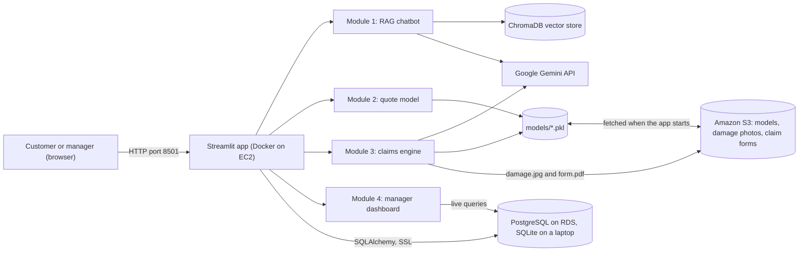

# Acko AI Platform

An insurance assistant built as one web app (Streamlit). A customer can ask questions about Acko policies, get a motor
insurance quote, and file a claim with a damage photo and a claim form. A manager can follow the claims on a live dashboard. Four modules are built and can be deployed on AWS:

| Module | Page in the app | What it does |
|---|---|---|
| 1. Policy chatbot (RAG) | Policy Chatbot | Answers questions from 3 Acko policy PDFs with Google Gemini, shows the source page, and sends the customer to the quote or claim page when that is what they ask for. |
| 2. Premium quote predictor | Get a Quote | Machine-learning model (car and bike) that estimates the yearly premium, explains it with SHAP (rupees per factor) and saves every quote in the database. |
| 3. AI claims engine | File a Claim | Gemini Vision reads the damage photo and the claim form (PDF). Four models give the claim amount and the approval probability. The photo and the form go to Amazon S3, the claim to the database. |
| 4. Management dashboard | Dashboard (manager sign-in only) | Live numbers from the database: claims today, this week and this month, approval rate, average payout and premium, the cities with the most claims (bar chart), the claim trend (line chart), the 10 questions customers asked most this week and the claims waiting for a human decision. A period filter and a Refresh button read the database again. |

Not built: Module 5 (manager assistant, natural language to SQL). The app already has its place (`views/assistant.py`, shown only to a signed-in manager).

## Results at a glance

All numbers come from runs on held-out test data and are written to `reports/`. The data and the policy PDFs are synthetic
course material, so these numbers say how well the models learn this data, not how an insurer would perform.

| Part | Result | Details |
|---|---|---|
| Chatbot search | the right passage is in the top 5 for 20 of 20 brief questions, and 44 of 45 extra questions | `reports/rag_eval.md` (the 20 questions were partly used while tuning, the extra 45 are the fairer number) |
| Chatbot answers | 20 of 20 answers contain the key fact; 18 of 20 came in under the brief's 5 seconds (median 1.5 s, slowest 5.9 s) | `reports/rag_eval.md` |
| Quote model (IDV up to Rs 10 lakh) | car R2 0.9912, RMSE Rs 1,323; bike R2 0.9939, RMSE Rs 539 | `reports/quote_eval.md`, `notebooks/02_quote_model.ipynb` |
| Claims, car | amount R2 0.9971, RMSE Rs 57,972; approval accuracy 94.2 %, F1 approved 0.966, F1 rejected 0.792 | `reports/claims_eval.md`, notebooks 03 and 04 |
| Claims, bike | amount R2 0.9959, RMSE Rs 4,613; approval accuracy 94.5 %, F1 approved 0.969, F1 rejected 0.745 | `reports/claims_eval.md`, notebooks 05 and 06 |
| Damage photo test | damage type right on 6 of 9 labelled photos; the brief's target of 8 of 10 was NOT met | `reports/vision_eval_set1.md` |

## How it fits together



- **Chatbot:** the 3 PDFs are cut into 536 chunks, plus 119 FAQ questions, and stored in ChromaDB (default ONNX MiniLM
  embeddings, no key needed). A question is answered from the best passages found by meaning (vectors) and by words
  (BM25), merged by reciprocal rank fusion. A simple rule-based router decides: policy question, quote or claim.
- **Quote model:** one HistGradientBoosting model for cars and one for bikes, trained on log(premium). Columns that would
  leak the answer are left out. SHAP shows how many rupees each factor adds or takes away.
- **Claims engine:** Gemini returns the damage type, a severity score (1-10) and the parts seen in the photo, and reads the
  form. The customer checks every detail. Two models per vehicle type (amount, approval) give the estimate. A claim at or
  above the approval threshold (default 0.5) is `approved`, every other claim is `review`: the machine never rejects.
  Files are saved under `claims/{user_id}/{claim_id}/damage.jpg` and `form.pdf`.
- **Dashboard:** shown only after the manager sign-in. Every number is a live query on the four tables (`acko/dashboard_data.py`, plain SQL that gives the same answer on SQLite and PostgreSQL) and nothing is cached, so a new claim shows as soon as the page reads the database again (Refresh button). It shows claims today, in the last 7 days and this month, the approval rate, the average payout and premium, the cities with the most claims, the claim trend, the top 10 chatbot questions of the week and the claims waiting for human review. The period filter changes everything except the three claim counters and the question list. A new database is empty, so `python -m scripts.seed_demo_data` can add clearly labelled demo customers ("Demo Customer N") with quotations, claims and chatbot questions, all priced and decided by the trained models, so that the dashboard has something to show; `--remove` deletes them again.
- **Database:** four tables (`users`, `quotations`, `claims`, `chat_logs`). SQLite on a laptop, PostgreSQL on AWS RDS. The PostgreSQL schema is in `docs/schema_postgresql.sql`, and a few real sample rows of every table (the people made anonymous) are in `docs/sample_records.sql`: `psql -f docs/schema_postgresql.sql -f docs/sample_records.sql` builds a small sample database.

## Project layout

```
app.py                 the web app (sign-in, menu, pages)
views/                 one file per page: chat.py, quote.py, claims.py, dashboard.py (manager only)
acko/                  the code behind the pages: rag, quote, claims, vision, storage, db, dashboard_data, model_store, config
scripts/               one-off commands, run as: python -m scripts.<name>
models/                the trained models (.pkl)
data/policy_pdfs/      the 3 Acko policy PDFs     data/eval/   the evaluation questions
notebooks/             one notebook per ML model (quote, car amount, car approval, bike amount, bike approval)
reports/               evaluation reports, SHAP pictures (reports/shap/)
docs/                  the PostgreSQL schema (schema_postgresql.sql) and the sample records (sample_records.sql)
deploy/                AWS scripts: acko_aws_foundation.sh (run in CloudShell), ec2_deploy.sh (run on the server)
Dockerfile             the image of the app          requirements.txt + constraints.txt   the packages
```

## Run it on your own PC (Windows PowerShell)

You need Python 3.11, Git and a free Gemini API key from https://aistudio.google.com/apikey.

```powershell
git clone https://github.com/Dewakaran0416/acko-ai-platform.git
cd acko-ai-platform
py -3.11 -m venv venv
.\venv\Scripts\Activate.ps1
pip install -r requirements.txt -c constraints.txt
Copy-Item .env.example .env          # then open .env and fill in GEMINI_API_KEY (and MANAGER_PASSWORD if you want a manager login)
python -m scripts.check_gemini       # does the key work?
python -m scripts.init_db            # creates the 4 tables in a local SQLite file
python -m scripts.build_index        # builds the ChromaDB knowledge base (first run downloads about 80 MB)
streamlit run app.py                 # opens http://localhost:8501
```

With `S3_BUCKET` empty, claim files are kept in the folder `uploads/`. With `DB_HOST` empty, the database is the file
`acko.db`. Nothing needs AWS on a laptop.

Useful commands: `python -m scripts.ask "What is the waiting period for health insurance?"` (chatbot in the terminal),
`python -m scripts.show_quotes` and `python -m scripts.show_claims` (the newest rows in the database),
`python -m scripts.check_deploy` (checks settings, database, S3, models, vector store and Gemini in one go).
The Dashboard page is only for the manager: put a password in `MANAGER_PASSWORD` in `.env`, then use "Manager sign-in" on the first page.

### Use Amazon S3 from your PC (optional)

1. In the AWS console create a private S3 bucket (block all public access) in region `ap-southeast-2`.
2. `python -m scripts.aws_setup policy BUCKET` prints the permission policy for an IAM user (limited to this bucket).
3. Create the IAM user with that policy and an access key, then run `python -m scripts.aws_setup keys BUCKET`. The secret key is typed
   hidden and saved outside the project folder. The command also writes `S3_BUCKET`, `AWS_PROFILE` and `AWS_REGION` into `.env`.
4. `python -m scripts.test_storage` saves, reads, lists and deletes a test photo and a test PDF, and checks that they are encrypted and private.

### Retrain the models (optional)

The trained models are in `models/`, so this is not needed to run the app. To train again you need the course dataset (4 CSV files):

```powershell
python -m scripts.import_data "C:\path\to\DataSet.zip"      # copies the CSV files to data/raw/ (never committed)
python -m scripts.train_quote                                # models/quote_model.pkl, reports/quote_eval.md, SHAP pictures
python -m scripts.train_claims                               # four models/claim_*.pkl, reports/claims_eval.md
python -m scripts.make_notebooks                             # rebuilds and runs the notebooks in notebooks/
python -m scripts.sync_models upload                         # puts the models on S3 (needed for the AWS server)
```

### Checks that prove the parts work

| Command | What it proves |
|---|---|
| `python -m scripts.eval_rag --answers` | chatbot search (20 + 45 questions), intent routing, Gemini answers and their speed |
| `python -m scripts.test_vision` | Gemini reads the four generated sample claim forms and a photo |
| `python -m scripts.eval_vision` | the labelled photo test (labels are written first, then Gemini is asked) |
| `python -m scripts.test_storage` | file storage on S3 (or `uploads/`) from end to end |
| `python -m scripts.init_db` | creates the 4 tables (safe to run again) and proves that every table can be written |
| `python -m scripts.export_schema` | writes `docs/schema_postgresql.sql` from the models in `acko/db.py` |
| `python -m scripts.export_sample_records` | writes `docs/sample_records.sql`: the newest rows of every table, with names, e-mail addresses, phone numbers, policy numbers and registrations made anonymous |
| `python -m scripts.check_dashboard` | every number on the dashboard equals the database (the same questions asked again with separate SQL) |
| `python -m scripts.seed_demo_data` | optional: adds 24 demo customers ("Demo Customer N") with 160 quotations, 70 claims and 200 chatbot questions, priced and decided by the trained models, so that the dashboard has something to show. `--remove` deletes only them, `--refresh` moves their dates up to today |
| `python -m scripts.check_deploy` | everything the platform needs works on this computer or server |

## Deploy on AWS (EC2 + RDS + S3, region ap-southeast-2 Sydney)

What you need: an AWS account, a private S3 bucket (the default name in the scripts is `acko-claims-dewa-2026`; set
`ACKO_BUCKET` to use another name), a Gemini key, and the models uploaded to the bucket (last command above).

**A. Build the AWS pieces (a few minutes; the database then needs roughly 10 more minutes to become ready).** Open AWS CloudShell in the
console (region Sydney) and run:

```bash
curl -fsSL https://raw.githubusercontent.com/Dewakaran0416/acko-ai-platform/main/deploy/acko_aws_foundation.sh -o acko_aws_foundation.sh
bash acko_aws_foundation.sh
```

The script asks once for a database password (hidden, 12 or more letters and digits) and builds, or reuses if they exist:

- two firewall groups: `acko-ec2-sg` (web port 8501 open to the world) and `acko-rds-sg` (database port 5432 only from the server);
- the PostgreSQL database `acko-db` on RDS (db.t4g.micro, 20 GB, encrypted, private, no public address);
- the role `acko-ec2-role`: the server may use only this S3 bucket (read and write objects), look up the database address, and use Session Manager. No access key is ever put on the server;
- the server `acko-server` (EC2 t3.small, Amazon Linux 2023, encrypted disk, IMDSv2) with Docker installed, and a fixed address (Elastic IP).

No SSH port is open. You open a terminal on the server with Session Manager (EC2 console > select the server > Connect > Session Manager).
`bash acko_aws_foundation.sh status` prints the summary again at any time.

**B. Start the app on the server.** In the Session Manager terminal:

```bash
sudo mkdir -p /opt/acko && sudo env GIT_TERMINAL_PROMPT=0 git clone --branch main https://github.com/Dewakaran0416/acko-ai-platform.git /opt/acko/src && sudo sed -i 's/\r$//' /opt/acko/src/deploy/*.sh && sudo bash /opt/acko/src/deploy/ec2_deploy.sh
```

`deploy/ec2_deploy.sh` checks the server, finds the database address by itself, asks for three secrets (hidden): the database password, the
Gemini key and a manager password. It saves them in `/opt/acko/acko.env` (readable by root only, never in Git or in the image), builds
the Docker image (roughly 10 minutes), starts the container `acko` (restarts by itself after a reboot), waits until the app answers, runs
the deployment check and prints the public address: `http://<fixed address>:8501`.

**C. Look after it.**

| Task | Command on the server |
|---|---|
| deployment check | `sudo docker exec acko python -m scripts.check_deploy` |
| app log | `sudo docker logs --tail 100 acko` (the image build log is `/var/log/acko-build.log`) |
| update after a `git push` | `cd /opt/acko/src && sudo git pull && sudo bash deploy/ec2_deploy.sh` |
| change the secrets | `sudo bash /opt/acko/src/deploy/ec2_deploy.sh --new-secrets` |
| fill the dashboard with demo rows (optional) | `sudo docker exec acko python -m scripts.seed_demo_data` (take them away with `--remove`) |

How the pieces use AWS:

- **Models:** the server sets `MODELS_FROM_S3=true`, so when the app starts it fetches the five model files from `s3://BUCKET/models/` (the copy inside the image is the fallback). The sidebar shows how many were checked and downloaded.
- **Claim files:** `claims/{user_id}/{claim_id}/damage.jpg` and `form.pdf` in the bucket, encrypted (SSE-S3), private.
- **Database:** PostgreSQL on RDS, connection with SSL required. The tables are created by the app when it starts.
- **Vector store:** ChromaDB is built from the PDFs while the Docker image is built and is saved inside the image.

**D. Remove everything when you are done** (the resources cost a few dollars a week, the Free plan credits of a new account cover that). In the AWS
console delete, in this order: the EC2 server `acko-server`, the Elastic IP `acko-eip`, the RDS database `acko-db` (no final snapshot),
the security groups `acko-rds-sg` and `acko-ec2-sg`, the DB subnet group `acko-db-subnets`, the role `acko-ec2-role` and its instance
profile. Keep the S3 bucket if you want to keep the files and models.

## Settings (environment variables)

A `.env` file on a laptop, `/opt/acko/acko.env` on the server. Real environment variables win over `.env`. Nothing secret is in the code or in Git.

| Name | Meaning |
|---|---|
| `GEMINI_API_KEY`, `GEMINI_MODEL` | Google Gemini key and model (default `gemini-3.1-flash-lite`) |
| `MANAGER_PASSWORD` | password of the manager sign-in (no manager sign-in when empty) |
| `DB_HOST`, `DB_PORT`, `DB_NAME`, `DB_USER`, `DB_PASSWORD`, `DB_SSLMODE` | PostgreSQL on RDS (empty `DB_HOST` = SQLite file) |
| `S3_BUCKET`, `AWS_REGION` | bucket for claim files and models (empty `S3_BUCKET` = folder `uploads/`) |
| `AWS_PROFILE` | only on a laptop: the saved access key; on EC2 the server's role is used |
| `MODELS_FROM_S3` | `true` on the server: fetch the models from S3 at start |
| `APPROVAL_THRESHOLD` | probability from which a claim is `approved` (default 0.5) |

## Security notes

- No key or password is in the repository (`.env` is git-ignored; the Docker image is built without it).
- The server has no SSH port and no stored AWS key; it uses an IAM role that is limited to one bucket. The database is private and accepts only the server.
- Files and models on S3 are private and encrypted; the database connection uses SSL.
- The app is served over plain HTTP on port 8501 (no domain, no certificate). For real customers put it behind HTTPS (a load balancer or a proxy with a certificate).
- The sign-in asks only name and e-mail; there is no password for customers. Do not use real customer data.

## Limitations and assumptions

- The datasets and the policy PDFs are synthetic. Results describe these data only.
- The chatbot's intent router is rule-based. Gemini on the free tier is usually fast (1 to 2 seconds) but sometimes stalls, and its answer time is not under the app's control.
- Quote model: the error figures hold for IDV up to Rs 10 lakh (the form's range). The car IDV floor in the form is Rs 50,000, as in the brief, although the data starts near Rs 94,000.
- Claims: the approval label in the data is partly random, so about 94 % accuracy is the ceiling. The F1 of the rejected class alone is below 0.80. At the default threshold 0.5, about 23 % (car) and 30 % (bike) of really rejected claims in the test data would be approved at once. The threshold is a business choice.
- Claim amount errors are larger for small claims (bike, IDV up to Rs 50,000: about 16 %).
- The damage photo test did not reach the brief's target (6 of 9 right in the first run), and Gemini's reading of a photo can be wrong: the customer can correct every detail before saving.
- SHAP uses the Permutation explainer (additive), not TreeExplainer. It explains how the model reaches its number, not why a real insurer would pay.
- One server, no automatic scaling, RDS backups kept 1 day, region Sydney (a real Indian insurer would keep customer data in India).
- Module 5 (manager assistant) is not built.
- Dashboard: it reads the database when the page opens, when the period changes and when Refresh is pressed (there is no automatic refresh). "This week" means the last 7 days. Managers share one password (there are no personal manager accounts). The review list shows every claim that the model sent to review (a low approval probability is a reason to look at a claim, not proof of fraud); the app does not record what the manager decides. Demo rows added with `python -m scripts.seed_demo_data` are ordinary rows in the tables, so the dashboard counts them; their customers are called Demo Customer N and `--remove` deletes them.

## Tools and AI assistance

Google Gemini is used inside the app (answers, photo and form reading). The code, tests, notebooks, deployment scripts and this
documentation were written step by step with the help of Claude, an AI assistant from Anthropic. The author ran every step
on his own computer, checked the results, made the decisions and takes responsibility for the project. The numbers in this file come
from runs in this repository (see `reports/`).
